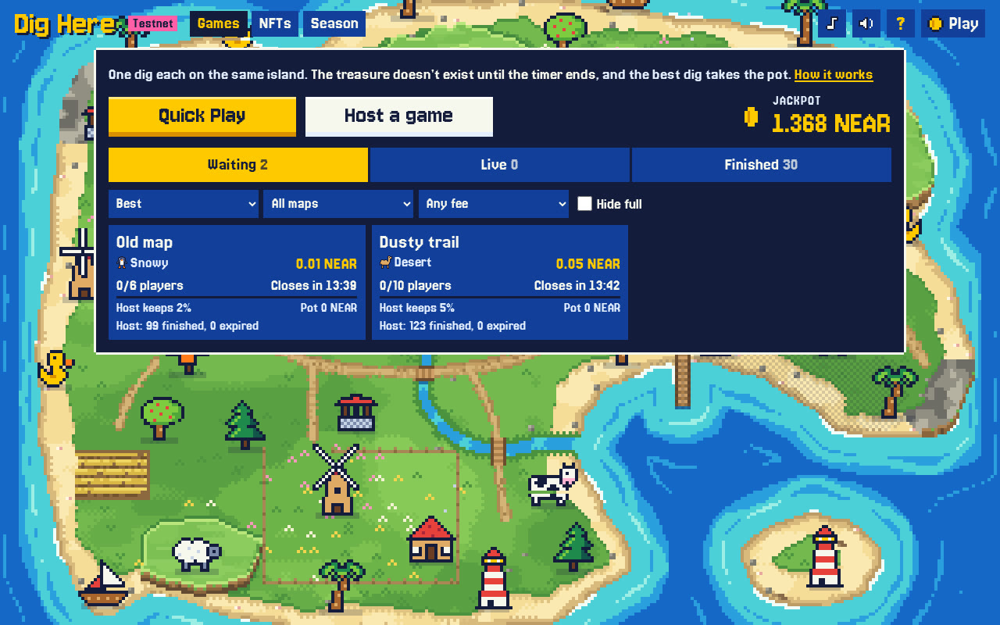
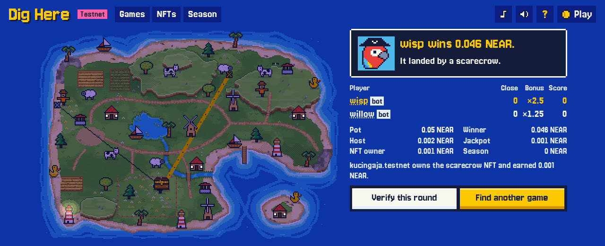
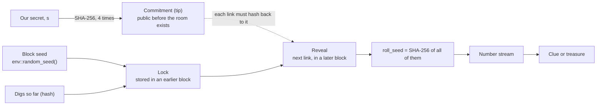
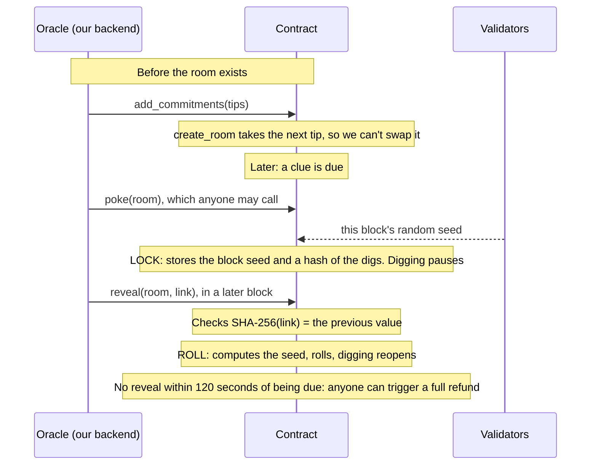
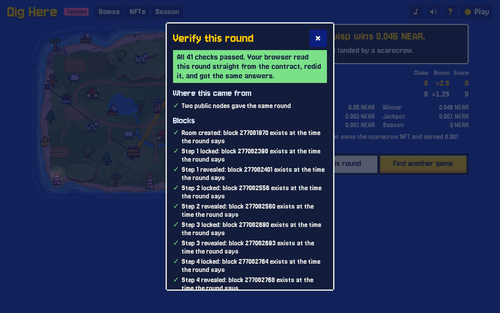
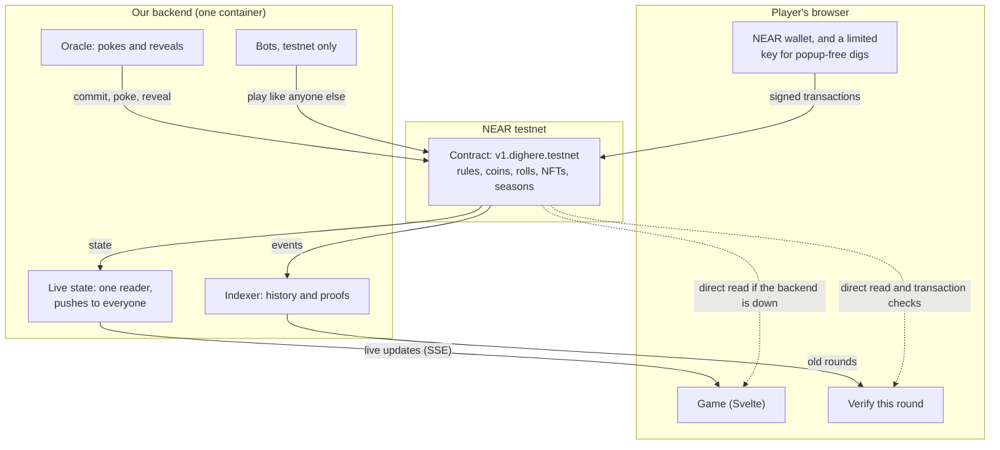
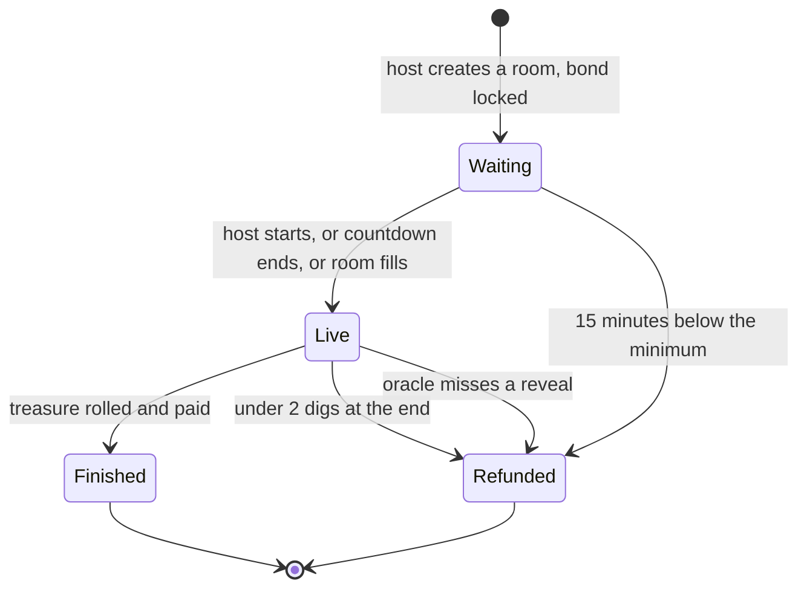

# Dig Here

A multiplayer treasure-digging game on NEAR **testnet**. Everyone in a room gets one dig on the same pixel-art
island. Clues arrive one by one, each worth a lower bonus, so digging early pays more and digging late is safer.
The treasure doesn't exist until the timer ends: then the contract rolls it, and the best dig takes the pot. Any
player can redo the whole round in their browser and check that nobody rigged it. Coins here are test coins with no
value.

Built at the NEAR Hackathon, for the Games track. The repository's history starts on 5 Nov 2026.

| | |
| --- | --- |
| Live testnet game | https://dighere.space |
| Playtest in the browser, no wallet or chain | `VITE_BACKEND=dummy npm run dev`, see [Try it in 1 minute](#try-it-in-1-minute) |
| Game contract | [`v1.dighere.testnet`](https://testnet.nearblocks.io/address/v1.dighere.testnet) |
| Market contract | [`market.dighere.testnet`](https://testnet.nearblocks.io/address/market.dighere.testnet) |
| One-minute video | [docs/dig-here-showcase.mp4](docs/dig-here-showcase.mp4) |
| Every contract method and event | [contract/README.md](contract/README.md), [contract-market/README.md](contract-market/README.md) |



## The problem

Guessing games and treasure hunts have two known faults:

- **Someone has to hide the answer, and that person can cheat.** A host who knows the spot can play their own
  game, sell the answer, or move it.
- **"Provably fair" usually means "trust our server".** The roll happens somewhere players can't see, and the proof
  is a hash they're told to check later, if they ever do.

Dig Here changes both:

- **There is no answer to hide.** The treasure doesn't exist until the timer ends. The host sets only the fee,
  timer, map and their cut, and never picks a spot or writes a clue.
- **The contract does every roll, in public.** Each roll needs a NEAR block seed and a secret we committed to before
  the room existed. Neither side can steer it alone, and **Verify this round** redoes the whole round in your browser.

## Try it in 1 minute

The playtest build runs the whole game in your browser on a fake chain, with bots and controls to speed it up. No
wallet, no chain, nothing to sign up for. Needs Node 24.

```sh
npm install
VITE_BACKEND=dummy npm run dev
```

Open the address Vite prints (http://localhost:5173).

1. A short how-to-play opens. Press **Skip**. You see the lobby with about 20 bot-hosted games, and you're signed in
   as `you.near` with 0 NEAR in the game and 50 NEAR in a pretend wallet.
2. Press **Quick Play**. The wallet window says you need more coins. Press **5**, then **Top up 5 NEAR**.
3. Close the window and press **Quick Play** again. You join a room where bot players are already waiting, and the
   fee comes out of your game balance.
4. Open **Playtest controls** and press **Start now**. The round starts on clue 1, YOLO, at ×2.5.
5. Tap the map, then press **Dig here**. Your X lands, and "You'd win on N of N spots right now" changes as the
   clues arrive.
6. Press **Skip to next clue** to see clues 2 to 4 narrow the spots, or **×20** to run the clock fast. **End game**
   rolls the treasure and shows the scores and the pot split.
7. **Force jackpot**, **End season** and **Reset everything** in the same panel show the rarer outcomes.

## Play on testnet



1. Get a testnet wallet. [Meteor Wallet](https://wallet.meteorwallet.app) runs in your browser. Choose testnet and
   create an account ending in `.testnet`. Then paste its name into the
   [NEAR faucet](https://docs.near.org/getting-started/faucet) for free test coins. The game shows these same steps
   under **No testnet wallet yet?** That faucet allows about 10 requests per connection every 12 hours, so a shared
   network can run out: the help says what to do then.
2. Open https://dighere.space. See a short how-to-play. Tap through or skip it. You can watch any round and open
   **Verify this round** without a wallet.
3. Press **Quick Play**, then **Connect NEAR wallet**, and approve the sign-in. This adds a limited key to your
   account, which can play but can't withdraw or touch NFTs.
4. Choose how many coins to add, and approve that once. It pays this game's fee, and the rest stays in your game
   balance. The next games and every dig then need no popup.
5. Wait a few seconds. See labelled bots join and the round start on clue 1, YOLO, at ×2.5. Or press **Host a game**
   instead: you join your own room with the same approval, bots arrive in seconds, and you press **Start now**.
6. Tap the map, then press **Dig here**. See your X land at once, then "You'd win on N of N spots right now".
7. Watch clues arrive, the bonus fall, and your winning spots change.
8. When the timer ends, see the spots flash, the chest drop, the scores, and the pot split.
9. Press **Verify this round**. See each check recalculated in your browser.
10. Go to **NFTs**, open **Mint**, pick one and mint it. Then open it under **Mine** and list it. Minting, listing,
    changing a price, taking it off the market, buying, sending and withdrawing each ask your wallet once. A buyer
    pays from their wallet and the seller is paid to theirs.

## Check the live contract without a wallet

Read the game straight from the chain, with our backend not involved (needs `curl` and `jq`):

```sh
curl -s https://test.rpc.fastnear.com -H 'Content-Type: application/json' -d '{"jsonrpc":"2.0","id":1,"method":"query","params":{"request_type":"call_function","finality":"final","account_id":"v1.dighere.testnet","method_name":"live_state","args_base64":"e30="}}' | jq -r '.result.result | implode' | jq '{version, jackpot, rooms: [.rooms[] | {room_id, name, status}]}'
```

You'll see the open rooms, each with its `room_id`, `name` and `status` (`waiting` or `live`), and the `jackpot` in
milliNEAR. Run it again a minute later and `version` has gone up, because the bots keep hosting and joining. Put
`get_season` or `get_jackpot` in `method_name` for the season's pool and leaders, or the jackpot alone. Every view
is listed in [contract/README.md](contract/README.md#views).

## The game

A host opens a room and sets the entry fee, timer, map, their share of the pot (20% at most), and the minimum and
maximum players, up to 12 in the host form because last-clue digs barely win in bigger rooms. Players join and the
fee locks. They can leave before the start and get it back. Each game rolls new landmark positions on the map.

**Four clues**, each worth a lower bonus. The screen always shows how many spots are still possible.

| Clue | Says | Bonus |
|---|---|---|
| 1. YOLO | Nothing | ×2.5 |
| 2. Category | "Near an animal" | ×1.5 |
| 3. Kind | "Near a horse" | ×1.25 |
| 4. Detail | "Near a horse, close to water" | ×1 |

**You get one dig. Score = closeness × bonus × crowding.** Closeness runs from 1000 on the treasure's own pixel down
to 0 at 96 pixels away (48 for rooms before 175, which keep the rule they started under). Digging within 6 pixels of
an earlier dig multiplies your score by 0.85. When the timer ends the treasure is rolled, and the best score wins the
pot. Ties go to whoever dug first. With fewer than 2 digs, everyone is refunded.

**The pot:** host cut (0–20%), jackpot 3%, NFT owner 2%, season pool 1%, and the winner gets the rest.

**Around the rounds:**
- **Jackpot:** dig on the treasure's exact pixel to win it. A win pays at most 100× that round's pot.
- **NFTs:** one NEP-171 token for each kind of landmark on each map, 36 in all. The first owner mints it, and the
  money goes to the project (0.5 NEAR on testnet, planned 20 NEAR in production). The owner earns 2% of the pot when
  the treasure lands by that kind. Selling goes through a separate market contract, `market.dighere.testnet`, with no
  owner and no fee: the seller approves the market on the NFT at their price (NEP-178), the buyer pays that price
  from their wallet, not the game balance, and the seller is paid straight to their wallet. A listing ends if its NFT
  moves any other way.
- **Season:** points scaled by the pot, with prizes for the top 3.
- **Hosts:** each room locks a small bond, and hosts have a public record, so spam rooms sink down the board.

## Fairness: why nobody can rig a round

**There's no hidden answer to steal.** The treasure doesn't exist until the timer ends, so a host, a player or we
can't know where it is, because it isn't anywhere yet. The host only sets the fee, timer, map and their cut, and
never picks a location or writes a hint.

**Nobody controls the dice alone.** Every clue and the treasure come from two sources: a seed from the NEAR block,
and a secret we committed to before the room existed. Each is useless without the other.

**You don't have to trust us.** The contract does every roll in public, and "Verify this round" lets you redo the
whole round in your browser.

### Who could cheat, and what stops them

| Who | What they might try | What actually happens |
|---|---|---|
| **Host** | Pick the spot, or play with inside knowledge | They choose no location, and know nothing other players don't. They can play their own room on equal terms |
| **Player** | Copy a good dig | Allowed, but they get a lower bonus, and digging within 6 pixels of an earlier dig scores ×0.85 |
| **Player** | Use a contract to read the seed, then act on it | The block seed alone isn't enough, because the result also needs our secret, which isn't public yet |
| **Validator** | Predict the block's seed, and skip a transaction they dislike | They can predict the seed, as NEAR's docs warn, but they don't have our secret, so they can't work out the result |
| **Us (oracle)** | Choose a result | Our secret was fixed by a hash before the room existed, and the block seed doesn't exist until later, so we can't steer a roll |
| **Us (oracle)** | Dig with the next clue in hand | Digs are refused between a lock and its reveal, usually for about 2 seconds, so nobody holding the secret can use it |
| **Us (oracle)** | Refuse to reveal a result we dislike | **This is possible.** It's public, and everyone gets a full refund. See [Known limits](#known-limits) |
| **Backend down** | Coins stuck | Anyone can call `poke`, and a missing reveal refunds everyone after 120 seconds. The backend isn't needed for that |

## How the randomness works

### The two seeds



### One roll, step by step

Each round has 4 rolls: clue 2, clue 3, clue 4 and the treasure.



**The order is what makes this safe.** The block seed is fixed first, while our link is still secret, so the
validator is blind when its block is made. Our link comes second, but it was fixed by the hash long before, so we
can't choose it. All we can do is refuse, and that's public.

### The exact formulas

```
tip        = H(H(H(H(s))))                              H = SHA-256
reveals    = step 1 H(H(H(s))), step 2 H(H(s)), step 3 H(s), step 4 s

roll_seed  = H("dig-here-v1" || room_id || step || lock_seed || link || digs_hash)
layout     = H("dig-here-layout-v1" || room_id || block_seed || tip)

stream     = H(seed || 0), H(seed || 1), ... read as 32-bit numbers
below(n)   = take the next number under the largest multiple of n, then mod n
```

- **`below(n)` has no modulo bias:** numbers that would favour some results are thrown away.
- **`digs_hash` is taken at the lock,** so a dig placed afterwards can't affect that roll.
- **The landmark layout** uses the block seed and the tip only. It's public before anyone joins and decides nothing
  by itself, so it doesn't need the two-step process.
- **Each room uses its own commitment** and each link works once, so a reveal can't be replayed or reused.

Byte-level details are in [`contract/tests/README.md`](contract/tests/README.md).

### How a clue picks the treasure's spot

Nothing is chosen ahead of time. Each roll picks only from what still fits, and then forgets the pick:

1. **Clue 1, YOLO:** no roll. All 40 landmarks are possible.
2. **Clue 2:** picks a landmark at random and announces its category. Only that category stays possible.
3. **Clue 3:** picks again among those, and announces its kind.
4. **Clue 4:** picks again, and announces a detail, like "close to water".
5. **Treasure:** picks one remaining landmark, then a spot on land within 13 pixels of it.

## Prove it yourself



Press **Verify this round** on any finished round. Your browser redoes the round with the same rules code and shows
each check, line by line:

| Check | What it proves |
|---|---|
| Every link hashes back to the tip | Our secret was fixed before the room existed |
| Each `roll_seed` recalculates | Nothing else went into the roll |
| Layout, clues and treasure come out the same | The contract used the seeds honestly |
| Scores, ranking and pot split come out the same | Nobody's score or payout was altered |
| Every transaction was sent to our contract, and matches | The round really happened on chain |

**Where the data comes from:** a recent round is read straight from the contract through public RPC, with our backend
not involved. Older rounds are deleted from the contract to free storage, so our backend supplies them, and your
browser checks each one against the chain by transaction. If a line can't be checked, it shows amber and the headline
won't claim a full pass. A forged round goes red, and tests cover forged winners, changed digs, swapped links,
missing results and transactions from the wrong contract.

**What it can't prove alone:** the block seed the contract saw isn't the `random_value` shown in a block's header, so
your browser can't compare the two. For that one value you rely on NEAR running the public contract correctly, and
the screen says so.

**Same rules twice:** the rules exist in TypeScript and in Rust. [`contract/tests/vectors.json`](contract/tests/vectors.json)
holds both to identical answers, across hundreds of cases.

## Architecture



| Part | Decides | Can't do |
|---|---|---|
| **Contract** | Every rule, roll and coin | Change rules or move player coins: it has no owner or admin methods. On testnet the deployer can still redeploy the code, see [Known limits](#known-limits) |
| **Oracle** | Only *when* due steps are sent | Choose a result, or touch coins. It can refuse to reveal, which refunds everyone |
| **Live state** | Nothing | It only saves reads. Browsers fall back to the chain if it's down |
| **Indexer** | Nothing | It keeps history. Verify rechecks what it says |
| **Bots** | Their own digs, using only public clues | See anything a player can't. They can't win season prizes, and won't exist in production |

The backend reads the chain through FastNEAR first. When FastNEAR refuses or rate-limits, reads go to QuickNode if
one is set, then to dRPC. A send that gets lost is sent again down every backup at once. They carry the same signed
bytes, so only one copy can land, and the backend watches the transaction hash rather than trusting any one answer.

## Game flow

### A room's life



### A round for a player

1. **Connect** a testnet wallet. One approval adds a limited key, which can play but can't withdraw or touch NFTs.
2. **Join:** one approval attaches the fee and a small top-up. Later rounds pay from your game balance with no popup.
   You can leave before the start and get your fee back.
3. **Clue 1, YOLO, ×2.5:** dig blind for the biggest bonus, or wait.
4. **Clues 2 to 4, ×1.5, ×1.25, ×1:** each narrows the possible spots. A dig's bonus follows the clues actually
   revealed, so a late clue never costs you. If you've dug, you see "You'd win on 2 of 4 spots right now" change live.
5. **Time's up:** the treasure is rolled, and the highest score wins the pot.
6. **Paid:** winnings land in your game balance straight away, ready for the next round or to withdraw.

### Where coins can't get stuck

| Situation | What happens |
|---|---|
| Room never fills | Everyone is refunded at the 15-minute deadline. The host loses 10% of the bond |
| Host disappears | The deadline handles it, and anyone can trigger it |
| Under 2 digs | Everyone is refunded |
| Oracle doesn't reveal, or the backend dies | Anyone can trigger a full refund 120 seconds after the roll was due |
| Joined but never dug | Your fee stays in the pot, and you get a warning before the end |

Winnings are credited to balances inside the contract, not pushed out, so one bad account can't block a payout.
Withdrawals deduct first and restore the coins if the transfer fails.

## What NEAR does here

- **Function-call access keys** make digs popup-free. Signing in adds a key limited to `join`, `leave`, `start`,
  `dig`, `create_room` and `poke` on the game contract, through `function-call-key-plugin`. It can't attach coins,
  so it can't withdraw or touch NFTs.
- **Block randomness** (`env::random_seed()`) is one of the two seeds behind every roll. It's locked in one block and
  combined with our committed secret in a later one, so neither a validator nor we can steer it.
- **NEP-171** is the landmark NFT: 36 tokens, each earning 2% of every pot whose treasure lands by its kind.
  **NEP-178** approvals let the separate market contract sell one without ever holding it.
- **NEP-297 events** (`EVENT_JSON:` logs) record every room, dig, lock, reveal and payout. The indexer reads them,
  and Verify checks them against the transactions.
- **Named sub-accounts** split the roles: `v1.dighere.testnet` (game), `market.dighere.testnet` (market),
  `oracle.dighere.testnet` (oracle), and eight bots such as `wisp.bots.dighere.testnet`, each with its own key and
  balance.
- **Promise callbacks** restore a balance when a withdrawal transfer fails, so a payout can't be lost or doubled.

Not used: NEAR Intents, Chain Signatures.

## Run it locally

```sh
npm install
VITE_BACKEND=dummy npm run dev     # the whole game with a fake chain and playtest controls
npm run sim                        # balance simulation
```

The contract builds in Docker: `docker/near cargo near build non-reproducible-wasm`, from `contract/`. Its tests,
methods and events are in `contract/README.md`. The backend needs testnet keys in `.kamal/secrets-testnet.env`, and
`server/run-local.sh` starts one copy. Don't run a second oracle against a live deployment.

## Tests

```sh
npm test               # 514 tests: rules, shared vectors, Verify, the wallet flows, the playtest chain
npm run test:server    # 59 tests: oracle, bots, indexer, RPC failover, the page's security headers
npm run check          # svelte-check over the whole app, 0 errors
```

```sh
cd contract
../docker/near cargo test --lib                                          # contract unit tests
../docker/near cargo test --test sandbox -- --test-threads=1 --nocapture # a real local NEAR node
```

The sandbox tests run the actual wasm: rooms, digs, every roll, refunds, missed reveals, withdrawals that fail and
restore, NFT minting, an in-place upgrade that keeps every balance, and a limited key that can play but not move
coins. `contract-market/tests/sandbox.rs` runs both contracts together: a sale from mint to a paid seller, refused and
failed buys that refund in full, and listings that end when the NFT moves.

## Deploy

The contract is deployed with the NEAR CLI inside `docker/near`. The steps, and the record of the live upgrade, are
in [contract/README.md](contract/README.md). The site and backend ship as one container with
[Kamal](https://kamal-deploy.org), behind Cloudflare at https://dighere.space. `config/deploy.yml` and `.kamal/` are
git-ignored, because they hold the host's address and the testnet keys.

## Known limits

- **Testnet only.** Bots are test-only and won't exist in production. Going to mainnet needs the items below first.
- **Randomness:**
  - We see a roll's result before revealing it, so refusing to reveal is a free way to cancel a round we dislike.
    It's public, counted by the contract (`missed_reveals`) and refunded, but with real money we'd need to lock up
    coins that are lost on a missed reveal.
  - Reveals don't currently wait for the lock to be final, so in theory a validator could drop the lock's block after
    seeing the link. `ORACLE_REVEAL_FINAL=1` closes this, for about 2 seconds more per roll.
  - A validator working together with us would know both seeds.
- **A stolen browser key** can't withdraw or touch NFTs, but it can spend the game balance by joining rooms.
  Production needs a spending cap. Disconnecting offers to remove the key through the wallet. If you decline or the
  wallet refuses, it stays on the account until you remove it in your wallet. This browser has forgotten it, but a
  copy that was already stolen would still work.
- **The contract can't tell a deleted account from any other,** so one that scored stays on the season list and its
  prize stays parked under its name. The list marks them. Season 1 holds this game's own deleted test accounts:
  `server/tools/reclaim.ts` can recover those coins, because the names are ours.
- **Scripts:** clues and landmarks are public, so a script can work out the exact spots that still fit.
- **Multiple wallets:** one person can dig from several, and farm seasons, though every dig costs a fee. Rules alone
  can't prevent this.
- **The contract deployer still holds a full-access key.** It should be removed before any real use.

Full findings: [docs/research/security-review.md](docs/research/security-review.md).

## Repo layout

```
contract/              Rust game contract (near-sdk 5): rooms, digs, rolls, coins, NFTs (NEP-171), seasons
  src/rng.rs           the two-seed roll and the number stream
  src/nft.rs           NEP-171 core, approvals and metadata
  tests/sandbox.rs     tests on a real local NEAR node
  tests/vectors.json   shared answers that hold the Rust and TypeScript rules together
contract-market/       Rust market contract: sells NFTs through NEP-178 approvals, with no owner
server/                Node 24 backend: oracle, bots, live state (SSE), indexer, RPC failover
src/                   Svelte 5 frontend
  lib/game/            the rules in whole-number maths; random.ts is the number stream and hashes
  lib/backend/         near.svelte.ts talks to the chain; dummy.svelte.ts is the playtest chain
  lib/verify*.ts       Verify this round
  lib/world/           the pixel-art islands
  lib/audio/           the original chiptune, synthesized in the browser
  components/          the screens
docker/                the NEAR toolchain image the contract builds and deploys with
docs/plans/            the design
docs/research/         measurements behind it, including the security review
docs/*.jpg, *.mp4      screenshots and the video in this README
```

## Built with

- **Contracts**: Rust, `near-sdk` 5.30, `near-contract-standards`.
- **Backend**: Node 24, TypeScript, `near-api-js` 7.4, SQLite.
- **Web**: Svelte 5, Vite 8, TypeScript, Vitest, `@hot-labs/near-connect` 0.11.4 for wallets with
  `function-call-key-plugin` 2.2.0 for the limited key. Fonts: Jersey 10 and Jersey 20 (OFL).
- **Art and sound**: pixel art drawn in code in `src/lib/world/`, and an original chiptune synthesized in the
  browser.
- **Hosting**: Kamal, Cloudflare.

The code was written with Claude Code.

## Status

Checked on 14 Nov 2026.

- **Testnet only, unaudited.** This is hackathon code.
- **Live:** `v1.dighere.testnet`, code hash `HeyyJyAWDijgD738tEAoKtydeQpHjtFygyz8uU8emjiA`, in season 9, with bots hosting
  and playing.
- **The deployer key is still there.** `v1.dighere.testnet` has one full-access key, so whoever holds it could
  redeploy the code. See [Known limits](#known-limits).
